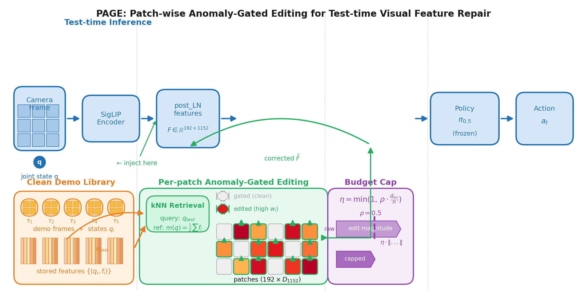

# PAGE

[](LICENSE) [](pyproject.toml) [](https://arxiv.org/)

PAGE is a training-free visual intervention for frozen vision-language-action policies. It uses clean demonstrations to build a pose-conditioned reference, detects patch-level deviations with a clean-calibrated exemplar-minimum gate, and edits only gated visual features before the policy action head.




## Method

At each policy query, PAGE retrieves the eight clean demonstration states closest to the current proprioceptive state. For each patch, the gate searches the K=8 reference tensors in a 9×9 local neighbourhood, takes the minimum normalized residual, and applies 3×3 max pooling. Thresholds are fitted with leave-one-out clean calibration and an automatically selected α for a 1.5% clean firing target. Active patches use PAR soft contraction toward the original-position K8 mean, with unit edit strength in the released unbudgeted configuration.

The policy weights remain frozen. Randomized evaluation images and success labels are excluded from calibration.

## Layout

- `src/page/core.py` contains the exemplar-minimum gate and PAR or hard-replacement writeback.
- `src/page/calibration.py` contains clean-only PCA fitting and leave-one-out α calibration.
- `src/page/reference.py` contains state-conditioned K8 retrieval and reference-bank construction.
- `configs/example.yaml` shows the released parameters.
- `docs/method.md` records the implementation contract.
- `docs/results.md` records the benchmark summary and evaluation scope.

## Results at a glance

The released configuration is the pooled 9×9 PAGE variant. Counts below are successful episodes over the stated evaluation set.

### RoboTwin 2.0, π0.5

| Task | Official vanilla C2C | Official vanilla C2R | Local vanilla C2C | Local vanilla C2R | PAGE C2C | PAGE C2R |
|---|---:|---:|---:|---:|---:|---:|
| `lift_pot` | 98/100 | 35/100 | 50/50 | 19/50 | 97/100 | 26/50 |
| `beat_block_hammer` | 93/100 | 23/100 | 85/100 | 6/50 | 92/100 | 19/50 |
| `rotate_qrcode` | 90/100 | 21/100 | 91/100 | 10/50 | 84/100 | 29/50 |
| `handover_mic` | 98/100 | 6/100 | 99/100 | 4/50 | 99/100 | 21/50 |
| `stack_blocks_two` | 91/100 | 43/100 | 93/100 | 22/50 | 89/100 | 32/50 |
| `move_can_pot` | 60% | 10% | 59/100 | 6/50 | 60/100 | 18/50 |
| `place_object_basket` | 70% | 29% | — | — | 70/100 | 31/50 |
| **Mean success rate** | **85.7%** | **23.9%** | **87.8% (6 tasks)** | **22.3% (6 tasks)** | **84.4%** | **50.3%** |

The current ledger covers seven RoboTwin tasks. The local vanilla averages exclude `place_object_basket`, for which no same-protocol local vanilla result is registered.

### VLA-Arena

| Frozen backbone | Official vanilla L0 | Official vanilla L1 | Local vanilla L0 | Local vanilla L1 | PAGE L0 | PAGE L1 |
|---|---:|---:|---:|---:|---:|---:|
| π0.5 | 88% | 6% | 132/150 | 9/150 | 132/150 | 51/150 |
| OpenVLA-OFT | 96% | 14% | 144/150 | 21/150 | 144/150 | 51/150 |
| **Mean success rate** | **92.0%** | **10.0%** | **92.0%** | **10.0%** | **92.0%** | **34.0%** |

### Physical dual-arm evaluation

On AgileX Cobot Magic dual-PiPER hardware, both methods completed 25/25 clean trials. Under visual interference, frozen vanilla achieved 14/25 and PAGE achieved 20/25.


The figure shows the dual-arm platform and representative clean and visual-interference rollouts.

PAGE adds under 10 ms of steady-state latency per policy step in the reported deployment measurements. The reference residuals remain resident on the GPU, with approximately 1.8 GiB additional allocated memory in that measurement.

## Minimal use

```python
from page import retrieve_k8_bank, patch_intervention_normres_v4

bank, reference, row_ids = retrieve_k8_bank(clean_states, clean_features, query_state, k=8)
repaired, telemetry = patch_intervention_normres_v4(
    query_features, background_mean, reference, basis, eigenvalues, residual_variance,
    thresholds, tau=3.0, residual_mean=residual_mean, residual_scale=residual_scale,
    reference_bank=bank, local_window=9, repair_mode="par",
)
```

The operator accepts torch tensors and is intended to run on CUDA with a benchmark-specific VLA serving adapter. The host adapter supplies the visual feature tensor, clean assets, and current state query.

For a self-contained synthetic example that runs without benchmark assets, see [`examples/minimal_repair.py`](examples/minimal_repair.py). Basic operator checks are in [`tests/test_core.py`](tests/test_core.py).

## Environment

The released utilities require Python 3.10 or newer, NumPy, and PyTorch. Install a PyTorch build matching the target CUDA runtime for closed-loop use. The repository does not bundle benchmark datasets, model weights, or demonstration features.

## Citation

Please cite the PAGE paper when using the method. The paper draft and benchmark-specific evidence are maintained separately from this public code snapshot.

```bibtex
@misc{page2026,
  title        = {PAGE: Repurposing Clean Demonstrations for Test-Time Visual Feature Repair in Frozen VLA Policies},
  author       = {{PAGE authors}},
  year         = {2026},
  howpublished = { arXiv preprint },
  url          = {https://github.com/madman008qqas/PAGE}
}
```
