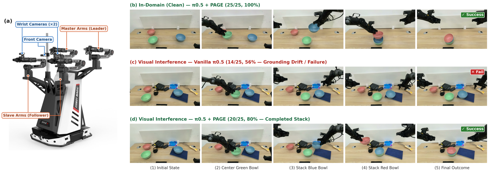

<div align="center">

# PAGE: Repurposing Clean Demonstrations for Test-Time Visual Feature Repair in Frozen VLA Policies

[](LICENSE)
[](pyproject.toml)
[](pyproject.toml)
[](#citation)

[Paper](#citation) · [Project Page](#key-results) · [Method](#method-overview) · [Key Results](#key-results) · [Quickstart](#quickstart) · [Citation](#citation)

PAGE is a training-free visual intervention for frozen vision-language-action policies.
It repurposes clean demonstrations at test time to repair patch features before action prediction.

**Highlights**

- Training-free inference with frozen policy weights
- Clean-only state-conditioned memory and no external VLM
- Under 10 ms steady-state latency in the reported deployment measurement
- Evaluation across RoboTwin 2.0, VLA-Arena, and a physical dual-arm platform

</div>

## Release status

- [x] PAGE/PAR operator, clean-only leave-one-out calibration, synthetic example, and unit tests
- [ ] arXiv preprint, project page, and real-robot comparison videos

## Teaser


PAGE detects visual feature deviations against a proprioception-anchored clean memory and repairs only the gated patches.

## Key results

### RoboTwin 2.0 with π0.5

The released configuration is the unbudgeted pooled 9×9 PAGE method. Values are success rates.

| Task | Official vanilla C2C | Official vanilla C2R | PAGE C2C | PAGE C2R |
|---|---:|---:|---:|---:|
| `lift_pot` | 98% | 35% | 97% | 52% |
| `beat_block_hammer` | 93% | 23% | 92% | 38% |
| `rotate_qrcode` | 90% | 21% | 84% | 58% |
| `handover_mic` | 98% | 6% | 99% | 42% |
| `stack_blocks_two` | 91% | 43% | 89% | 64% |
| `move_can_pot` | 60% | 10% | 60% | 36% |
| `place_object_basket` | 70% | 29% | 70% | 62% |
| **Mean success rate** | **85.7%** | **23.9%** | **84.4%** | **50.3%** |

The C2R mean changes from 23.9% to 50.3% (**+26.4 pp**), while the C2C success rate is almost unaffected.

### VLA-Arena

| Frozen backbone | Official vanilla L0 | Official vanilla L1 | PAGE L0 | PAGE L1 |
|---|---:|---:|---:|---:|
| π0.5 | 88% | 6% | 88.0% | 34.0% |
| OpenVLA-OFT | 96% | 14% | 96.0% | 34.0% |
| **Mean success rate** | **92.0%** | **10.0%** | **92.0%** | **34.0%** |

PAGE improves the reported L1 means by **+28 pp** for π0.5 and **+20 pp** for OpenVLA-OFT, with L0 unchanged.

### Physical dual-arm evaluation

On AgileX Cobot Magic dual-PiPER hardware, both methods completed 25/25 clean trials. Under visual interference, frozen vanilla achieved 14/25 and PAGE achieved 20/25.

| Condition | Frozen vanilla | PAGE | Δ |
|---|---:|---:|---:|
| In-domain clean | 25/25 (100%) | 25/25 (100%) | 0 pp |
| Visual interference | 14/25 (56%) | 20/25 (80%) | +24 pp |



### Deployment overhead

The reported deployment measurement adds 8.9–10.0 ms steady-state latency and approximately 1.8 GiB of GPU memory for the resident reference residuals.

## Method overview


- **Proprioception-Anchored Clean Memory.** Retrieve the K=8 clean demonstration states nearest to the current proprioceptive state.
- **Asymmetric 9×9 Exemplar-Minimum Gate.** Calibrate clean leave-one-out thresholds with strict 1×1 matching at a 1.5% clean firing target. At test time, compare each query patch with the valid 9×9 neighbourhoods of the K exemplars and apply 3×3 max pooling.
- **Closed-Form PAR Soft Contraction.** Contract active patches toward the original-position K8 mean. `repair_mode="hard_replace"` is available only for controlled ablations.

## Quickstart

```bash
git clone https://github.com/madman008qqas/PAGE.git
cd PAGE
pip install -e .
python examples/minimal_repair.py
pytest
```

For a frozen VLA adapter, provide the policy feature tensor, clean feature bank, current proprioceptive state, and calibrated tensors:

```python
from page import retrieve_k8_bank, patch_intervention_normres_v4

bank, reference, row_ids = retrieve_k8_bank(clean_states, clean_features, query_state, k=8)
repaired, telemetry = patch_intervention_normres_v4(
    query_features, background_mean, reference, basis, eigenvalues, residual_variance,
    thresholds, tau=3.0, residual_mean=residual_mean, residual_scale=residual_scale,
    reference_bank=bank, local_window=9, repair_mode="par",
)
```

## Repository layout

- `src/page/core.py` — exemplar-minimum gate and PAR or hard-replacement writeback
- `src/page/calibration.py` — clean-only PCA fitting and leave-one-out calibration
- `src/page/reference.py` — state-conditioned K8 retrieval
- `configs/example.yaml` — released parameters
- `docs/method.md` — implementation contract
- `docs/results.md` — benchmark summary
- `examples/minimal_repair.py` — synthetic end-to-end example
- `tests/` — operator tests

The repository contains no private datasets, model checkpoints, rollout logs, or benchmark-specific launchers.

## Citation

```bibtex
@misc{page2026,
  title        = {PAGE: Repurposing Clean Demonstrations for Test-Time Visual Feature Repair in Frozen VLA Policies},
  author       = {{PAGE authors}},
  year         = {2026},
  howpublished = {arXiv preprint},
  url          = {https://github.com/madman008qqas/PAGE}
}
```

## License

PAGE is released under the MIT License. See [LICENSE](LICENSE).
